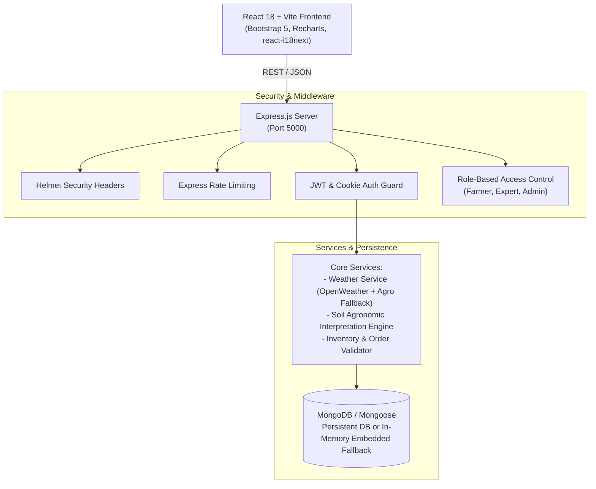

# 🌾 Agri-Tech — Smart Farming Management System

A modern, production-grade, full-stack MERN (MongoDB, Express, React, Node.js) web application designed to empower farmers, agricultural scientists, and administrators with real-time agro-meteorology, NPK soil diagnostics, crop cycle scheduling, pest early warning bulletins, certified inputs marketplace, and expert consultation.

---

## 📋 Table of Contents
- [1. System Architecture & Tech Stack](#1-system-architecture--tech-stack)
- [2. Key Features & Modules](#2-key-features--modules)
- [3. Project Directory Structure](#3-project-directory-structure)
- [4. Environment Variables](#4-environment-variables)
- [5. Installation & Quick Start](#5-installation--quick-start)
- [6. Seed Data & Demo User Credentials](#6-seed-data--demo-user-credentials)
- [7. REST API Documentation](#7-rest-api-documentation)
- [8. Automated Testing & Verification](#8-automated-testing--verification)
- [9. Production & Security Considerations](#9-production--security-considerations)

---

## 1. System Architecture & Tech Stack



### Technology Matrix
- **Frontend**:
  - React 18 with Vite for lightning-fast HMR and bundle optimization
  - Bootstrap 5 for clean, accessible, mobile-first responsive layout
  - Recharts for interactive crop growth distribution and NPK soil fertility trends
  - react-i18next & i18next for multi-language localization (English & हिन्दी)
  - React Icons for consistent iconography
  - Axios client with bearer token injection and response interceptors
- **Backend**:
  - Node.js & Express.js REST API
  - MongoDB with Mongoose object modeling
  - Embedded In-Memory MongoDB (`mongodb-memory-server`) fallback for zero-configuration testing
  - JWT (JSON Web Tokens) with HttpOnly cookie support
  - bcryptjs for salted password hashing
  - express-validator for robust request validation and sanitization
  - Helmet & express-rate-limit for security hardening
- **Testing**:
  - Node.js test runner (`node --test`) with Supertest integration suite

---

## 2. Key Features & Modules

1. **Farmer Dashboard**:
   - Live metrics summary: registered farms, active crop cycles, upcoming field operations.
   - Agro-meteorological current summary and 7-day forecast.
   - Crop growth stage progress bars with health status badges.
   - Recent soil fertility scorecard and actionable pest alert banners.
   - Interactive Recharts bar and pie charts.
2. **Farm Management (CRUD)**:
   - Full management of land parcels with area, measurement units (acres, hectares, bigha), soil classifications, and irrigation systems (drip, sprinkler, canal, tube well).
   - Search, filter by soil/irrigation type, and grid/list view toggle.
   - Farmer ownership checks preventing cross-user data tampering.
3. **Crop Management & Timeline**:
   - Register crop batches linked to specific farm plots.
   - 6-stage lifecycle progression: Germination → Vegetative → Flowering → Fruiting → Maturity → Harvested.
   - Automated creation of calendar reminders upon crop registration.
   - Fertilizer application logs (date, dosage, fertigation/foliar method, notes).
   - Curated reference knowledge database for major staples (Wheat, Paddy, Cotton, Tomato, Soybean).
4. **Agro-Meteorology & Precautions**:
   - Weather queries by city, district, or GPS farm coordinates.
   - Temperature, feels-like, humidity, wind velocity, sunrise/sunset, and 7-day forecast.
   - Algorithmic smart precautions (e.g. postponing pesticide sprays before rainfall, heat stress mitigation).
   - Transparent data source reporting (Live OpenWeather API or calibrated agricultural simulation).
5. **Soil Health Diagnostics (NPK)**:
   - Input pH, Nitrogen, Phosphorus, Potassium, Moisture, and Organic Carbon.
   - Automated agronomical interpretation against regional reference thresholds.
   - Specific corrective amendment suggestions (Lime, Gypsum, Neem-coated urea, SSP/DAP, Vermicompost, MOP).
   - Chronological multi-year NPK historical trend charts.
   - Prominent educational disclaimer banner.
6. **Pest & Disease Early Warning**:
   - Regional pest bulletins with severity classification (Low, Medium, High, Critical).
   - Verified IPM management protocols published by certified agronomists and entomologists.
   - Farmer field symptom reporting interface.
7. **Agricultural Marketplace**:
   - Product catalog spanning seeds, fertilizers, drip equipment, and biopesticides.
   - Category filtering, price sorting, search, and organic verification filter.
   - Interactive shopping cart drawer.
   - Demo checkout simulation with server-side stock and price verification (zero real money charged).
   - Order history and logistics fulfillment tracking.
8. **Expert Consultations**:
   - Certified expert directory with credentials, languages, and ratings.
   - Structured inquiry booking form (crop, topic, preferred date, detailed symptoms).
   - Status workflow: Pending → Accepted → Completed.
   - Expert diagnostic prescriptions with scientific treatment recommendations.
9. **Kisan Community Forum**:
   - Peer discussion forum categorized by Crops & Soil, Pest Control, Equipment, and Market Prices.
   - Post creation, comment replies, upvoting, and community flag reporting.
10. **Farm Calendar**:
    - Calendar timeline of irrigation, fertilization, scouting, and harvest tasks.
    - One-click task completion toggle.
11. **Admin Control Center**:
    - High-level platform statistics and financial simulation overview.
    - User management with role promotion (Farmer, Expert, Admin) and account suspension.
    - Product catalog and inventory management.
    - Customer order status management.
    - Reported forum post moderation queue.
12. **Multilingual Localization**:
    - Instant switching between English (🇬🇧) and Hindi (🇮🇳).
    - Persistent language preference saved to localStorage.

---

## 3. Project Directory Structure

```
agri-tech/
├── client/                     # React Vite Frontend
│   ├── public/                 # Static assets
│   ├── src/
│   │   ├── assets/             # Brand logos & imagery
│   │   ├── components/common/  # Navbar, Sidebar, Footer, ProtectedRoute
│   │   ├── context/            # AuthContext, CartContext
│   │   ├── i18n/               # i18n config, en.json, hi.json
│   │   ├── layouts/            # MainLayout, PublicLayout
│   │   ├── pages/              # Landing, Dashboard, Farms, Crops, Weather, Soil, Pests, Marketplace, Orders, Consultations, Forum, Calendar, Admin, Profile
│   │   ├── services/           # Axios API client (api.js)
│   │   ├── App.jsx             # Route definitions
│   │   ├── index.css           # Agri-Tech custom design tokens
│   │   └── main.jsx            # Entry point
│   ├── index.html              # HTML template
│   ├── package.json
│   ├── vite.config.js          # Vite config with /api proxy
│   └── .env.example
├── server/                     # Node.js Express Backend
│   ├── scripts/
│   │   └── seed.js             # Standalone database seed script
│   ├── src/
│   │   ├── config/             # Database connection & MongoMemoryServer fallback
│   │   ├── controllers/        # Auth, Farm, Crop, Weather, Soil, Pest, Product, Order, Consultation, Forum, Activity, Dashboard, Admin
│   │   ├── middleware/         # Auth, Roles, ErrorHandler
│   │   ├── models/             # User, Farm, Crop, CropActivity, SoilTest, PestAlert, Product, Order, Consultation, ForumPost, ForumComment, Notification, WeatherCache
│   │   ├── routes/             # REST route endpoints
│   │   ├── services/           # WeatherService, SoilService
│   │   ├── utils/              # Token generator, autoSeed helper
│   │   ├── validators/         # express-validator rules
│   │   ├── app.js              # Express app configuration
│   │   └── server.js           # Server startup script
│   ├── tests/
│   │   └── api.test.js         # Automated Supertest backend test suite
│   ├── package.json
│   └── .env.example
├── package.json                # Root monorepo script runner
└── README.md                   # Documentation
```

---

## 4. Environment Variables

### Backend Configuration (`server/.env`):
```env
PORT=5000
NODE_ENV=development
# Standard MongoDB connection string (or fallback to embedded in-memory if empty/unavailable)
MONGODB_URI=mongodb://127.0.0.1:27017/agri_tech
JWT_SECRET=supersecretagritechjwtkey2026changethisinproduction!
JWT_EXPIRES_IN=7d
CLIENT_URL=http://localhost:5173
# Optional: Set your OpenWeather API key here (https://openweathermap.org/api)
OPENWEATHER_API_KEY=
USE_MEMORY_DB=false
```

### Frontend Configuration (`client/.env`):
```env
VITE_API_URL=/api
```

---

## 5. Installation & Quick Start

### Prerequisites:
- Node.js (v18+ or v20+)
- npm (v9+)
- *(Optional)* Local MongoDB or MongoDB Atlas URI (The application includes an embedded in-memory database fallback that starts automatically if local MongoDB is not running).

### Commands to Run the Application:

#### Option A: Running from Root Directory (Recommended)
```powershell
# Navigate to project folder
cd C:\Users\DELL\.gemini\antigravity\scratch\agri-tech

# Install server and client dependencies
npm run install:all

# Seed database with demo accounts, crops, farms, and marketplace products
npm run seed

# Run backend server
npm run server

# In a second terminal, run frontend React app
npm run client
```

#### Option B: Running Individual Services

**1. Start the Backend API (Port 5000):**
```powershell
cd server
npm install
npm run seed   # Seeds demo users, farms, crops, alerts
npm start      # Starts Express server on http://localhost:5000
```

**2. Start the Frontend Application (Port 5173):**
```powershell
cd client
npm install
npm run dev    # Starts Vite dev server on http://localhost:5173
```

Visit **`http://localhost:5173`** in your browser.

---

## 6. Seed Data & Demo User Credentials

The database is pre-seeded with realistic agricultural accounts for all three roles:

| Role | Name | Email | Password | Description |
| :--- | :--- | :--- | :--- | :--- |
| **Farmer** | Ramesh Patil | `farmer@agritech.com` | `FarmerPassword123!` | Manages 2 farms in Pune & Nashik with Cotton, Tomato, and Pomegranate. |
| **Farmer 2** | Priya Sharma | `priya.farmer@agritech.com` | `FarmerPassword123!` | Wheat producer in Ludhiana, Punjab. |
| **Agricultural Expert** | Dr. Anand Sharma | `expert@agritech.com` | `ExpertPassword123!` | Senior Agronomist & Soil Scientist. |
| **Plant Pathologist** | Dr. Sunita Patel | `dr.patel@agritech.com` | `ExpertPassword123!` | Entomologist & IPM Specialist. |
| **System Admin** | Administrator | `admin@agritech.com` | `AdminPassword123!` | Full control over users, inventory, and moderation. |

> 💡 **Tip:** On the Login page (`/login`), click any of the **One-Click Quick Fill** buttons to instantly populate demo credentials!

---

## 7. REST API Documentation

All protected endpoints require an `Authorization: Bearer <token>` header or HttpOnly cookie.

### Authentication (`/api/auth`)
- `POST /api/auth/register` - Create new farmer or expert account.
- `POST /api/auth/login` - Authenticate and return JWT token.
- `GET /api/auth/me` - Fetch profile of logged-in user.
- `PUT /api/auth/profile` - Update profile information.
- `PUT /api/auth/password` - Change account password.
- `POST /api/auth/logout` - Clear session token.
- `GET /api/auth/experts` - List certified agricultural experts.

### Farms (`/api/farms`)
- `GET /api/farms` - Get farmer's land parcels (supports `search`, `soilType`, `irrigationType`, `sort`).
- `POST /api/farms` - Register a new farm.
- `GET /api/farms/:id` - Single farm details with crops and soil history.
- `PUT /api/farms/:id` - Update farm details (ownership verified).
- `DELETE /api/farms/:id` - Delete farm and cascade remove associated crops.

### Crops (`/api/crops`)
- `GET /api/crops` - Get crops (supports `farm`, `season`, `category`, `status`, `search`).
- `POST /api/crops` - Add crop cycle (auto-generates farm calendar reminders).
- `GET /api/crops/:id` - Single crop timeline and fertilizer records.
- `PUT /api/crops/:id` - Update growth stage and health condition.
- `POST /api/crops/:id/fertilizer` - Log fertilizer application.
- `DELETE /api/crops/:id` - Delete crop cycle.
- `GET /api/crops/reference/database` - Curated agricultural reference library.

### Agro-Meteorology (`/api/weather`)
- `GET /api/weather?location=Pune` - Live conditions, 7-day forecast, and farming precautions.
- `GET /api/weather/farm/:farmId` - Weather customized to a specific farm plot.

### Soil Health Diagnostics (`/api/soil`)
- `GET /api/soil` - List farmer's soil test records.
- `POST /api/soil` - Log soil metrics (pH, N, P, K, moisture, organic matter) and trigger automated agronomic analysis.
- `GET /api/soil/history/farm/:farmId` - Historical comparison data for Recharts visualization.
- `DELETE /api/soil/:id` - Delete soil test record.

### Pest & Disease Alerts (`/api/pests`)
- `GET /api/pests` - Browse active pest bulletins (supports `crop`, `severity`, `status`, `search`).
- `POST /api/pests` - Report suspected pest (farmer) or publish verified advisory (expert/admin).
- `PUT /api/pests/:id/status` - Mark alert as Acknowledged or Resolved.
- `PUT /api/pests/:id/verify` - Expert verification and IPM protocol attachment.

### Marketplace & Demo Orders (`/api/products` & `/api/orders`)
- `GET /api/products` - Filtered product catalog (categories, organic tag, price sort).
- `POST /api/products` - Admin add product.
- `POST /api/orders` - Demo checkout with server-side inventory decrement and price validation.
- `GET /api/orders` - Farmer order history.
- `GET /api/orders/admin/all` - Admin order fulfillment overview.
- `PUT /api/orders/:id/status` - Admin update order status (Placed, Processing, Shipped, Delivered).

### Consultations & Forum (`/api/consultations` & `/api/forum`)
- `GET /api/consultations` - Inquiries for farmer or assigned expert.
- `POST /api/consultations` - Submit consultation inquiry to expert.
- `PUT /api/consultations/:id/respond` - Expert diagnostic prescription submission.
- `GET /api/forum/posts` - Community discussion topics with pagination and tags.
- `POST /api/forum/posts` - Publish new question/topic.
- `POST /api/forum/posts/:id/comments` - Reply to discussion.
- `PUT /api/forum/posts/:id/upvote` - Toggle upvote.
- `PUT /api/forum/posts/:id/report` - Flag content for moderation.

### Admin Console (`/api/admin`)
- `GET /api/admin/users` - Full user registry with role filter.
- `PUT /api/admin/users/:id/role` - Assign farmer, expert, or admin role.
- `PUT /api/admin/users/:id/status` - Suspend or reactivate user account.
- `GET /api/admin/moderation/forum` - Review flagged forum content.
- `PUT /api/admin/moderation/forum/:id` - Approve or remove reported post.

---

## 8. Automated Testing & Verification

The backend includes a comprehensive automated test suite testing critical end-to-end paths:
- Health check verification
- Farmer registration & JWT issuance
- Seeded administrator authentication
- Protected route authorization
- Farm parcel creation & retrieval
- Crop cycle registration with stage tracking
- Soil test submission & algorithmic NPK interpretation
- Agro-weather query & fallback precautions
- Marketplace catalog search
- Demo order workflow & server-side price enforcement
- Admin role restriction enforcement (403 Forbidden on farmer attempt)

### Run Tests:
```powershell
cd server
npm test
```

**Results:**
```
✔ GET /api/health - Health check endpoint should return 200 OK
✔ POST /api/auth/register - Register a new farmer
✔ POST /api/auth/login - Login as seeded admin
✔ GET /api/auth/me - Protected route access with JWT
✔ POST /api/farms - Create a new farm for authenticated farmer
✔ GET /api/farms - Farmer can fetch their farms
✔ POST /api/crops - Add crop to farm
✔ POST /api/soil - Submit soil test and verify automated agronomic interpretation
✔ GET /api/weather - Query weather with fallback / real API
✔ GET /api/products - Marketplace product list & search
✔ POST /api/orders - Demo order workflow with price/stock validation
✔ GET /api/admin/users - Admin role authorization check

12 passed, 0 failed
```

---

## 9. Production & Security Considerations

- **Password Hashing**: Passwords are encrypted using `bcryptjs` with 10 salt rounds and never exposed in API responses (`select: false`).
- **Authorization Enforcement**: Every backend route explicitly verifies resource ownership so farmers can only view and modify their own farms and crops.
- **Strict Server-Side Validation**: Marketplace pricing and inventory availability are verified against the database on checkout, ignoring any tampered frontend payload.
- **Rate Limiting & Security Headers**: Helmet protects against cross-site scripting (XSS), clickjacking, and MIME-sniffing, while rate limiting guards sensitive endpoints against brute-force attacks.
- **Graceful Third-Party Fallback**: The weather engine handles missing OpenWeather API keys without throwing uncaught exceptions, seamlessly providing calibrated agro-meteorological projections.
